# The fleet

How workbench runs on several machines, what each part does, and what
people and admins see of it. The decisions behind it, and every request
and file, are in the specification, [multi-node.md](multi-node.md).

The pictures are of `checks.multi-node`: a front, nodes `a` and `b`, and
made-up people, `alice` and `bob`, who own workspaces, and `carol`, an
admin. `nix run .#screenshots` takes them again into `docs/fleet`.

- [A front and its nodes](#a-front-and-its-nodes)
- [Three machines](#three-machines)
- [What people see](#what-people-see)
- [Where a new workspace goes](#where-a-new-workspace-goes)
- [Starting a workspace](#starting-a-workspace)
- [A node that doesn't answer](#a-node-that-doesnt-answer)
- [Closing a node](#closing-a-node)
- [Moving a workspace](#moving-a-workspace)
- [From a terminal](#from-a-terminal)
- [From one host to a fleet](#from-one-host-to-a-fleet)

## A front and its nodes

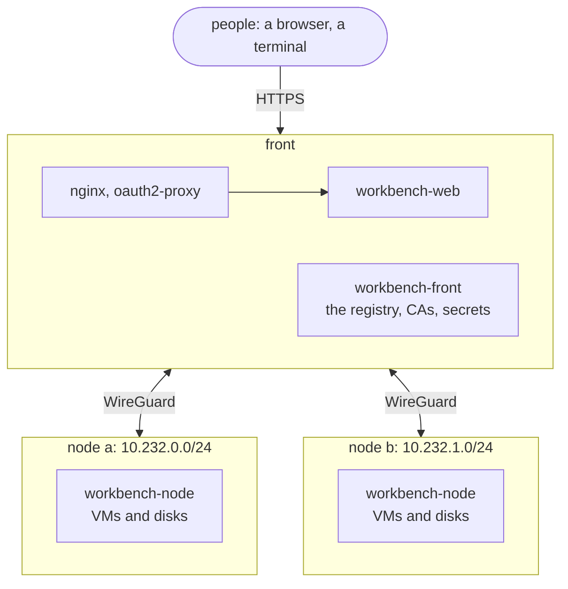

- **The front** is the one machine people reach. It signs them in, serves
  the UI and every app's address, and keeps what decides: the registry of
  who owns each workspace and which node it is on, the SSH CAs and host
  keys, the secrets, the paired computers and the quotas.
- **A node** runs workspaces' VMs and keeps their disks. It is reached by
  the front only, and is told at every start what the start needs.
- **WireGuard**, `wg-workbench`, UDP port 51820, joins them hub and spoke:
  each node is a peer of the front and of nothing else, so nodes never
  reach each other. A node keeps its tunnel up, so the front needs no
  node's address. Through it, the UI asks a node's API, `workbench-node`,
  on TCP port 7910, and a node asks the front's, `workbench-front`, on
  7911, for its starts.
- **One build.** The front and its nodes are deployed together. Each
  request between them carries the package's build; one of another build
  is refused.

A host on its own is a front and a node on one machine, which reaches its
node through Unix sockets, without WireGuard.

## Three machines

[examples/fleet](../examples/fleet) is a fleet of three machines, each a
`nixosConfiguration` of its own: the front, and nodes `a` and `b`.
`checks.fleet` evaluates them, so they stay what the module takes.

```text
examples/fleet/
├── flake.nix     # nixosConfigurations.front, .a and .b
├── fleet.nix     # the same on every machine
├── front.nix     # the front's role
├── node-a.nix    # node a's
├── node-b.nix    # node b's
└── hardware/     # each machine's hardware-configuration.nix: yours
```

Every machine is the module, the one fleet, its role and its hardware:

```nix
# flake.nix
machine = name: nixpkgs.lib.nixosSystem {
  system = "x86_64-linux";
  modules = [
    workbench.nixosModules.default
    ./fleet.nix            # the same on every machine
    ./${name}.nix          # this machine's role
    ./hardware/${name}.nix
  ];
};
nixosConfigurations = {
  front = machine "front";
  a = machine "node-a";
  b = machine "node-b";
};
```

**The fleet** is what all of them must agree on: the domain, the tunnel,
the nodes and the workspaces. A machine learns of the others only from
it, so it is one file, imported alike, and deployed to all of them.

```nix
# fleet.nix, in short
services.workbench.fleet = {
  domain = "ws.example.com";
  front.wireguard = {
    publicKey = "FRONT_PUBLIC_KEY=";
    endpoint = "front.example.com:51820";   # where nodes reach the front
  };
  nodes = {
    a = { subnet = "10.232.0"; wireguard = { address = "10.231.0.10"; publicKey = "A_PUBLIC_KEY="; }; };
    b = { subnet = "10.232.1"; wireguard = { address = "10.231.0.11"; publicKey = "B_PUBLIC_KEY="; }; };
  };
  workspaces = {
    alice = { node = "a"; owner = "alice"; ip = "10.232.0.10"; };
    bob = { node = "b"; owner = "bob"; ip = "10.232.1.10"; };
  };
};
```

**A role** is what only one machine has. The front has the UI, single
sign-on, the certificate and self-service; a node, its name, the
interface its workspaces go out through, and its own private key:

```nix
# front.nix, in short
services.workbench.front = {
  enable = true;
  virtualHost = { forceSSL = true; useACMEHost = "ws.example.com"; };
  wireguard.privateKeyFile = "/run/secrets/wireguard";
  oidc = { … };
  selfService = { … };
};

# node-a.nix
services.workbench.node = {
  enable = true;
  name = "a";                                # its name in the fleet's nodes
  network.externalInterface = "enp6s0";
  wireguard.privateKeyFile = "/run/secrets/wireguard";
};
```

| | `fleet.nix`, every machine | `front.nix` | `node-*.nix` |
|---|---|---|---|
| Domain, apps, packages, workspaces and their nodes | ✓ | | |
| Each node's subnet and tunnel address | ✓ | | |
| WireGuard | every public key, the front's endpoint | its private key | its private key |
| Web UI, single sign-on, certificate, self-service | | ✓ | |
| Its name, the workspaces' NAT interface | | | ✓ |

**Keys.** Each machine has a WireGuard key pair. The private key stays on
it, a file readable by `systemd-network`, such as a sops secret; the
public key goes in the fleet:

```sh
wg genkey | tee wireguard.key | wg pubkey   # the public key, for fleet.nix
```

**Deploying.** All three from one commit and one `flake.lock`: each
request between the front and a node carries the package's build, and one
of another build is refused both ways. A node left behind runs its VMs
but takes no new workspace, and its starts wait, until it catches up.

```sh
nixos-rebuild switch --flake .#front --target-host root@front.example.com
nixos-rebuild switch --flake .#a --target-host root@node-a.example.com
nixos-rebuild switch --flake .#b --target-host root@node-b.example.com
```

Each node brings `wg-workbench` up to the front's endpoint and keeps it
up; the front takes it as a peer by its public key. `alice` starts on `a`
and `bob` on `b`, each asking the front for its start. On the front,
`wg show wg-workbench` has a handshake with each node, and the host page
a section for each:

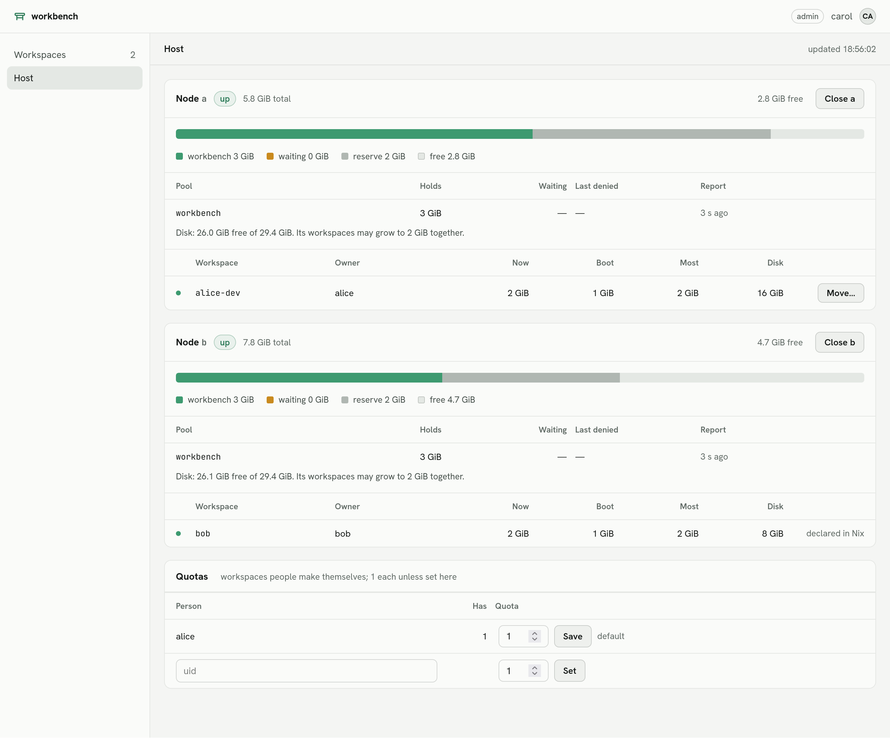

A declared workspace has no Move… there: its node is its `node` in Nix.

### Another node

To plug in `c`: a key pair on it; in `fleet.nix`, `nodes.c` with a
subnet and a tunnel address no other node has; a `node-c.nix` with
`name = "c"`; and `c = machine "node-c";` in the flake. Then deploy every
machine: the front peers with it, and the host page shows it once it
answers. New workspaces may go there from then on; none moves by itself.

The front may be a node too: `nodes.front` in the fleet, and `node` on in
`front.nix`, with `name = "front"`. It reaches its own node through Unix
sockets, without WireGuard. A host on its own is that, with no other
node, and no key at all.

## What people see

Owners see nothing of nodes. Their workspaces are where they always were;
one being moved is **Moving**, and one whose node doesn't answer is
**Unreachable**.

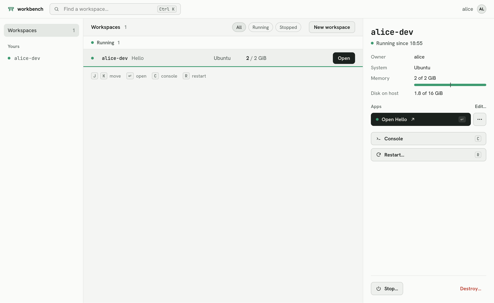

Admins see every workspace, and in its panel its node and address.

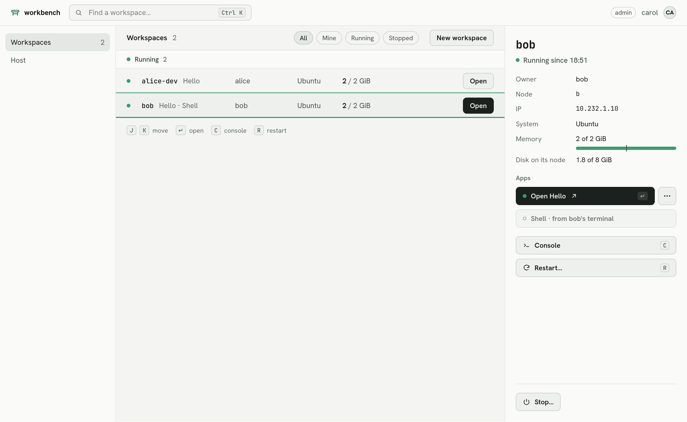

## Where a new workspace goes

A workspace made in the UI goes to the node an admin picks in New
workspace, or else to the open node with the most free memory: its
`MemAvailable`, less what no workspace grows into. That node must have the
workspace's boot memory free, its disk size free on disk, and as much
memory as the workspace may grow to; otherwise the request is refused.
The node is picked once, when it is made, and kept in the registry.

Owners pick nothing. An admin's New workspace lists every node with its
free memory, its workspaces' total maximum and its free disk, the one
placement would take preselected; a closed node, one that doesn't answer
and one of another build can't be picked.

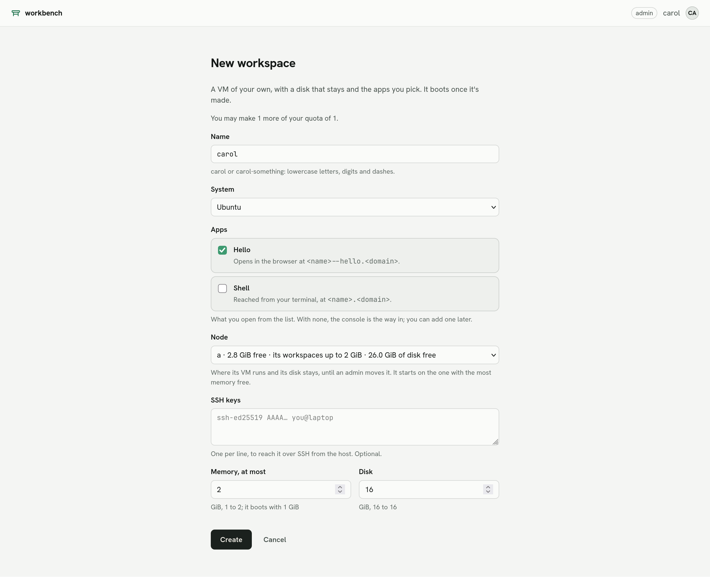

A declared workspace's node is its `node` in the fleet, with an `ip` in
that node's subnet.

## Starting a workspace

Every start asks the front, which answers a node only for its own
workspaces, from its tunnel address only:

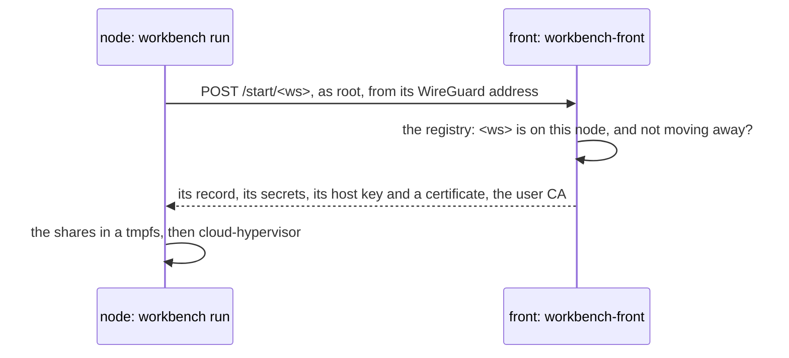

A node holds a workspace's secrets only while it runs, in its runtime
directory, never on its disk. A start the front refuses, or one while the
front can't be reached, is tried again every 10 seconds: a node that
reboots while its front is down waits, its workspaces with it, until the
front is back.

## A node that doesn't answer

Its workspaces are **Unreachable**, and their actions wait. Their apps
still answer while their VMs run: the front checks who may open an app
in its registry, not on the node. The tunnel to SSH refuses, since the
front can't tell their VMs run.

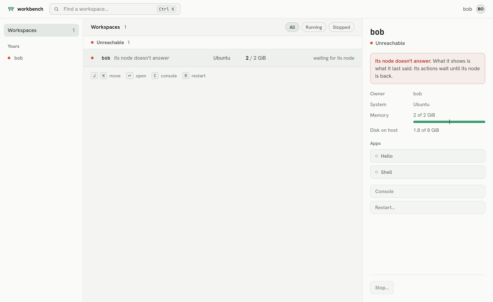

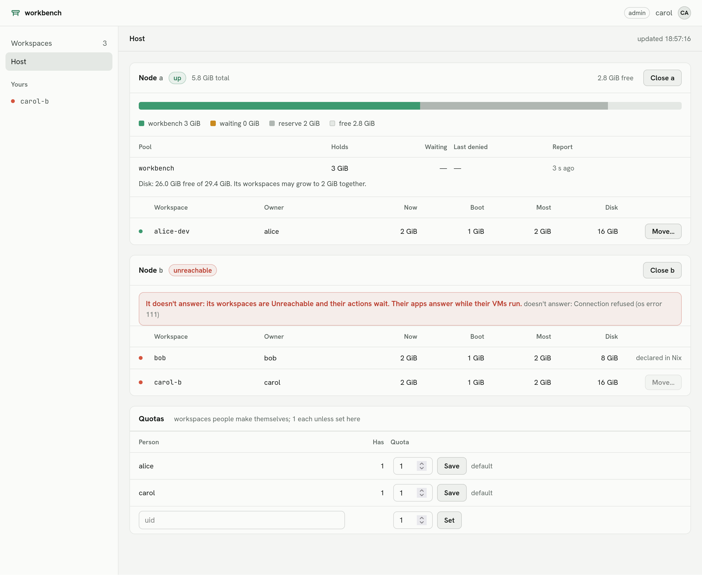

## Closing a node

An admin closes a node on the host page: it runs what it has, and takes
neither new workspaces nor moves, until Reopen. The front keeps it closed
across reboots, in `/var/lib/workbench/closed/<node>`. To empty a node,
for maintenance or to unplug it, close it and move its workspaces away.

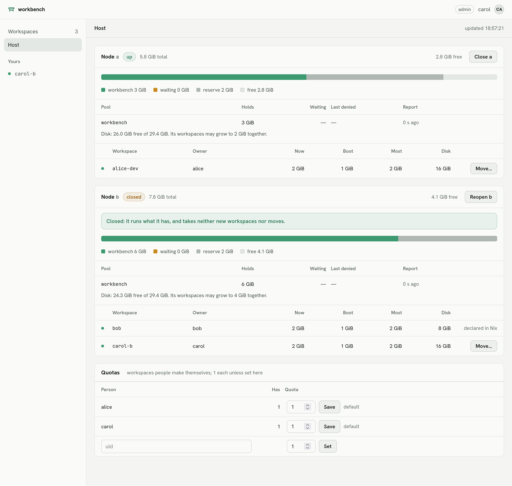

## Moving a workspace

An admin moves a workspace made in the UI with Move… on the host page, or
`workbench move <ws> <node>` on the front, to an open node of the same
build.

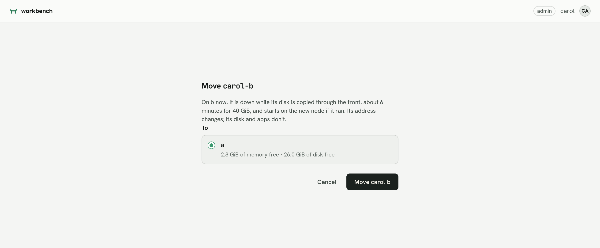

`workbench-move@<ws>` runs it on the front, in phases the registry keeps,
so a front that restarts in the middle picks it up where it was:

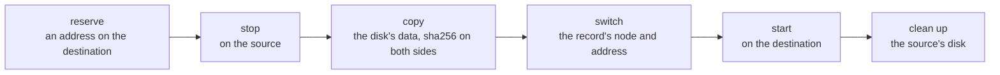

A move that fails before the switch goes back: the destination's copy
goes, and the workspace starts again on the source if it ran. One that
fails to start on the destination switches back first. A front restarted
in the middle goes back before the switch, and on after it. The source's
disk goes last. Only the disk's data travels, through the front:
40 GiB at 1 Gb/s is about 6 minutes, for which the workspace is down and
**Moving**.

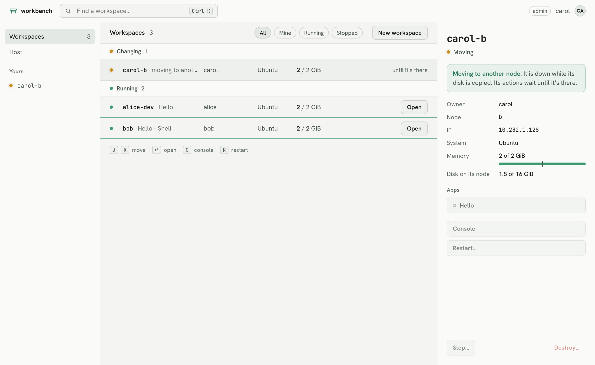

A move gives the workspace an address in the new node's subnet; an
Ubuntu guest's cloud-init sets it up again. A declared workspace moves
when its `node` and `ip` change in Nix: at the deploy, the front finds its
disk on another node and moves it through the same phases.

## From a terminal

A workspace's SSH server is reached through the front, from the person's
own computer, with nothing but HTTPS between them. Its Connect page makes
a pairing code, which `workbench-connect`, a static binary, trades for a
credential of that computer's:

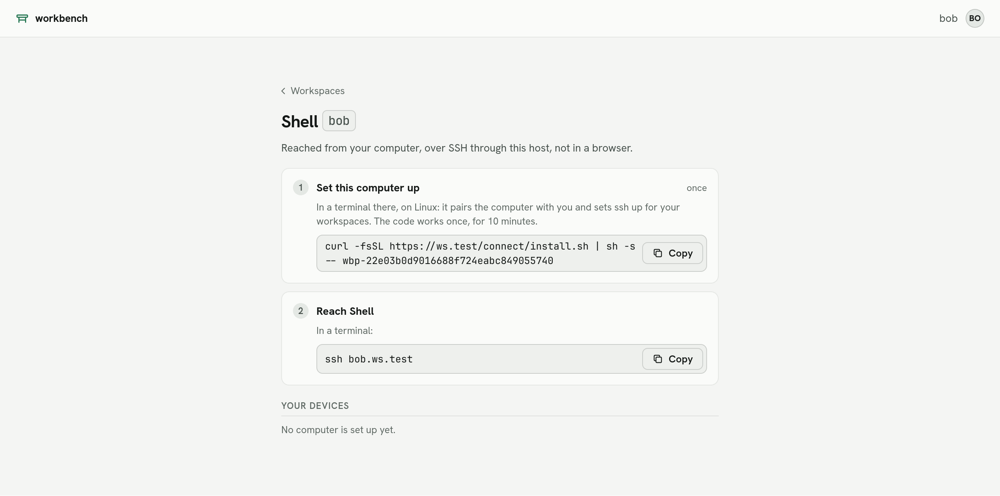

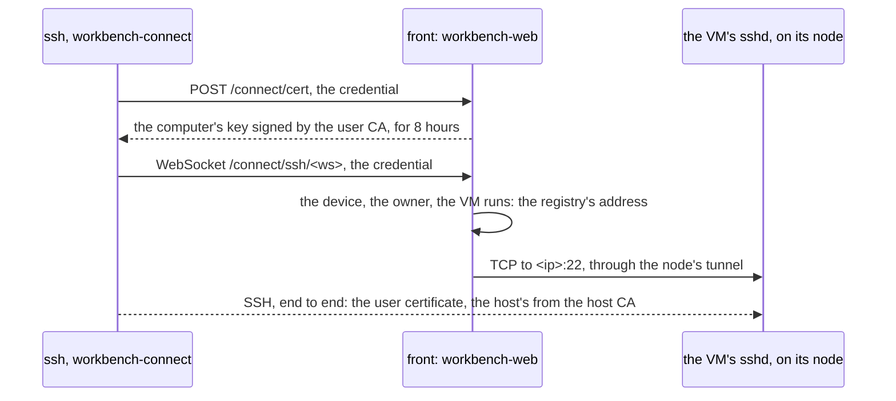

The front passes the session's bytes, and can't read them. While the
tunnel is open, it asks the device and the owner again every 30 seconds.
Your devices lists the computers paired, and revokes them, which ends
their sessions.

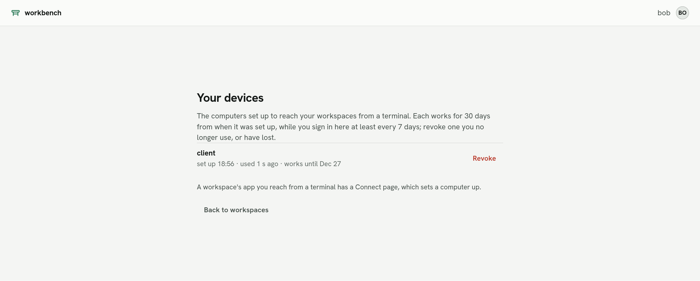

## From one host to a fleet

A host on its own already is a front and a node. Its first deploy as a
fleet makes a record of each workspace made in its UI, and restarts no
VM. A host that becomes the node of a new front takes its configs there
with `workbench front import`. The README's [From one host to a front
and a node](../README.md#from-one-host-to-a-front-and-a-node) has the
steps.
